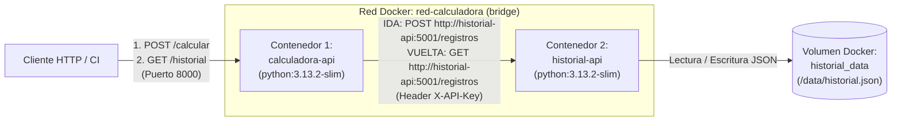

# Calculadora CI — Orquestación de Microservicios con Docker y GitHub Actions

Proyecto de **Integración Continua** que implementa una arquitectura de **dos servicios en contenedores Docker** comunicados a través de una red interna propia usando nombres de servicio DNS de Docker, persistencia con volúmenes, manejo seguro de variables de entorno y validación automatizada en **GitHub Actions**.

---

## 1. Estructura del repositorio por servicio

```text
calculadora-ci/
├── calculadora_service/          # Contenedor 1: API principal de cálculos (puerto 8000)
│   ├── app.py                    # Endpoints /health, /calcular (IDA) y /historial (VUELTA)
│   ├── requirements.txt          # Dependencias fijas (Flask, Requests)
│   ├── Dockerfile                # Imagen oficial python:3.13.2-slim (versión fija)
│   └── .dockerignore
├── historial_service/            # Contenedor 2: Microservicio API de persistencia/auditoría (puerto 5001)
│   ├── service.py                # Endpoints /health y /registros (guarda y lee en volumen /data)
│   ├── requirements.txt          # Dependencias fijas (Flask)
│   ├── Dockerfile                # Imagen oficial python:3.13.2-slim + VOLUME ["/data"]
│   └── .dockerignore
├── .github/
│   └── workflows/
│       └── ci.yml                # Pipeline CI: pruebas pytest (3.12, 3.13) + build y test Docker Compose
├── docker-compose.yml            # Orquestación de ambos servicios, red-calculadora, volumen y depends_on
├── .dockerignore                 # Exclusión de archivos innecesarios y sensibles en contexto Docker
├── .env.example                  # Plantilla de variables de entorno (sin secretos reales)
├── .gitignore                    # Excluye .env, __pycache__/ y .pytest_cache/
├── calculadora.py                # Módulo base de funciones aritméticas
├── test_calculadora.py           # Pruebas unitarias de calculadora
├── config.py                     # Configuración separada por ambientes (desarrollo, pruebas, produccion)
└── test_config.py                # Pruebas unitarias de configuración por ambiente
```

---

## 2. Arquitectura y comunicación entre contenedores



- **Contenedor 1 (`calculadora-api`):** Recibe las solicitudes de cálculo (`sumar`, `restar`, `multiplicar`, `dividir`, `potencia`), realiza la operación y se comunica con el Contenedor 2 usando exclusivamente el **nombre del servicio en la red de Docker** (`http://historial-api:5001`), nunca `localhost` ni direcciones IP fijas.
- **Contenedor 2 (`historial-api`):** Servicio independiente encargado de almacenar y consultar el historial de cálculos en un **volumen persistente** (`historial_data` montado en `/data/historial.json`), protegido mediante la clave `HISTORIAL_API_KEY` inyectada por variables de entorno.

---

## 3. Comandos para configurar y levantar los contenedores

### Paso 1: Crear el archivo `.env` local a partir de la plantilla
El archivo `.env` contiene el secreto `HISTORIAL_API_KEY` y **no se sube al repositorio** (está excluido en `.gitignore` y `.dockerignore`).

```bash
# En Linux / macOS / Git Bash
cp .env.example .env

# En Windows PowerShell
Copy-Item .env.example .env
```

*(Opcional)* Edite `.env` para definir su propio valor en `HISTORIAL_API_KEY`.

### Paso 2: Construir las imágenes y levantar los servicios con Docker Compose
```bash
docker compose up --build -d
```

Verificar que ambos contenedores estén en ejecución dentro de la red `red-calculadora`:
```bash
docker compose ps
```

---

## 4. Demostración de comunicación de ida y vuelta entre los dos contenedores

### A. Operación de IDA (Calcular en `calculadora-api` y guardar en `historial-api`)
Enviamos una petición `POST` al **Contenedor 1** (`http://localhost:8000/calcular`). Internamente, `calculadora-api` calcula `15 + 25 = 40` y hace un `POST` a `http://historial-api:5001/registros` a través de la red de Docker:

```bash
curl -X POST http://localhost:8000/calcular \
  -H "Content-Type: application/json" \
  -d '{"operacion": "sumar", "a": 15, "b": 25}'
```

**Respuesta esperada (`HTTP 201`):**
```json
{
  "a": 15.0,
  "b": 25.0,
  "guardado_en_historial_api": {
    "a": 15.0,
    "b": 25.0,
    "fecha_utc": "2026-11-10T01:30:00+00:00",
    "id": 1,
    "operacion": "sumar",
    "resultado": 40.0
  },
  "operacion": "sumar",
  "resultado": 40.0
}
```

### B. Operación de VUELTA (Leer desde `calculadora-api` los datos persistidos en `historial-api`)
Consultamos `GET http://localhost:8000/historial` en el **Contenedor 1**. Internamente, `calculadora-api` realiza una petición `GET` a `http://historial-api:5001/registros` y devuelve los registros guardados en el volumen del **Contenedor 2**:

```bash
curl http://localhost:8000/historial
```

**Respuesta esperada (`HTTP 200`):**
```json
{
  "datos": {
    "registros": [
      {
        "a": 15.0,
        "b": 25.0,
        "fecha_utc": "2026-11-10T01:30:00+00:00",
        "id": 1,
        "operacion": "sumar",
        "resultado": 40.0
      }
    ],
    "total": 1
  },
  "origen": "http://historial-api:5001"
}
```

### Paso 3: Detener los contenedores
```bash
# Detener conservando los datos del volumen
docker compose down

# Detener y eliminar también el volumen de datos
docker compose down -v
```

---

## 5. Ejecución de pruebas unitarias locales (`pytest`)

```bash
python -m pip install pytest
python -m pytest
```

---

## 6. Cumplimiento de criterios de evaluación (150 puntos)

1. **Repositorio del proyecto en GitHub (15 pts):** Estructura modular separada por servicio (`calculadora_service/` e `historial_service/`), historial de commits claros por cada etapa y este `README.md` detallado.
2. **Contenedor 1 — La aplicación (20 pts):** `calculadora_service/Dockerfile` basado en `python:3.13.2-slim` (versión fija, no `latest`), instalación de `requirements.txt`, `EXPOSE 8000` y `CMD ["python", "app.py"]`.
3. **Contenedor 2 — Segundo servicio (15 pts):** `historial_service/Dockerfile` con rol de microservicio API de persistencia/auditoría, configurado mediante variables de entorno (`HISTORIAL_PORT`, `HISTORIAL_DATA_FILE`, `HISTORIAL_API_KEY`) y con volumen `/data` para persistir los registros.
4. **Orquestación con Docker Compose (20 pts):** `docker-compose.yml` con ambos servicios (`calculadora-api` e `historial-api`), red propia `red-calculadora`, mapeo de puertos, inyección de variables (`env_file` y `environment`), volumen `historial_data` y `depends_on`.
5. **Comunicación entre contenedores (35 pts):** Comunicación HTTP interna mediante el nombre del servicio `http://historial-api:5001` demostrada con la operación real de ida (`POST /calcular`) y vuelta (`GET /historial`).
6. **Buenas prácticas y seguridad (15 pts):** Archivos `.dockerignore`, `.env` excluido del control de versiones, plantilla `.env.example` incluida y cero secretos en el código fuente.
7. **Integración con el pipeline de CI (15 pts):** El workflow `.github/workflows/ci.yml` ejecuta las pruebas en matriz Python `3.12`/`3.13`, construye las imágenes con `docker compose build`, levanta los contenedores con `docker compose up -d` y verifica automáticamente la operación de ida y vuelta en cada `push` y `pull_request`.
